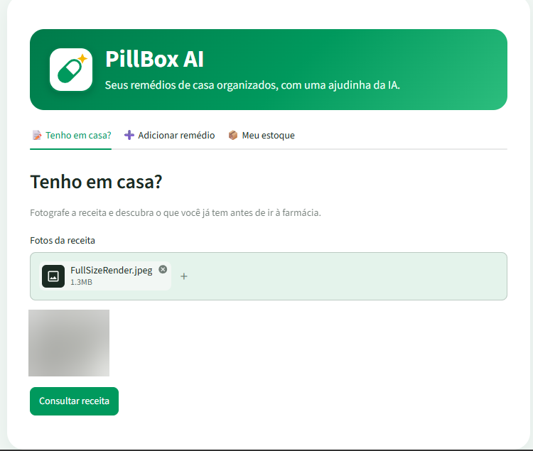
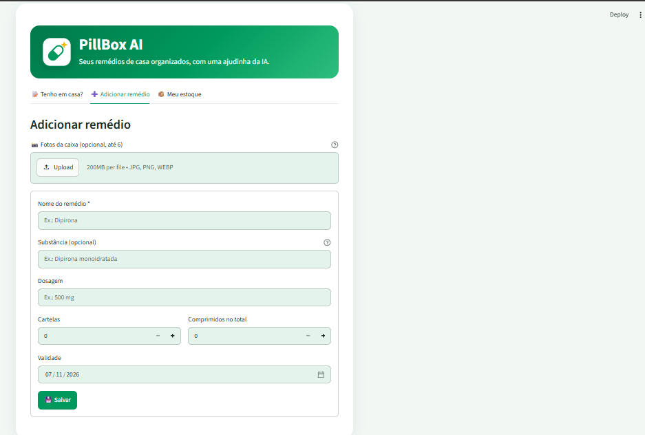
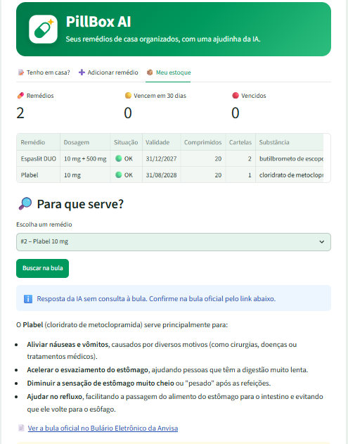

<p align="center">
  
</p>

<h1 align="center">PillBox AI</h1>

<p align="center">
  <b>Seus remédios de casa organizados, com uma ajudinha da IA.</b><br>
  Fotografe a receita e descubra, antes de ir à farmácia, o que você já tem em casa.
</p>

---

## 💡 O problema

Ao sair do médico com uma receita, é comum ir direto à farmácia e comprar um remédio
que já estava em casa, às vezes com outro nome comercial, ou descobrir depois que o
remédio de casa estava vencido. O **PillBox AI** resolve isso: ele organiza o estoque
de remédios da casa e responde, a partir da foto da receita, o que você já tem e o
que precisa comprar.

## ✨ Funcionalidades

| Função | O que faz |
|---|---|
| 📸 **Cadastro por foto** | A IA lê as fotos da caixa (frente, abas, laterais) e preenche nome, substância, dosagem, quantidade e validade |
| 📝 **Tenho em casa?** | A IA lê a receita médica e compara cada item com o estoque, reconhecendo equivalentes (ex.: "Metoclopramida" na receita = "Plabel" em casa) |
| 📦 **Controle de estoque** | Lista os remédios com alerta de validade: 🟢 OK, 🟡 vence em até 30 dias, 🔴 vencido |
| 🔎 **Para que serve?** | Explica, em linguagem simples, as indicações do remédio, com link para a bula oficial no Bulário Eletrônico da Anvisa |

## 📸 Demonstração

**📝 Tenho em casa?** A IA lê a receita e compara com o estoque, reconhecendo equivalentes:

<p align="center"></p>

**➕ Adicionar remédio:** fotografe a caixa e a IA preenche o cadastro:

<p align="center"></p>

**📦 Meu estoque:** validade, alertas e "Para que serve?":

<p align="center"></p>

## 🧠 Decisões técnicas

- **Humano no circuito:** a IA preenche o formulário, mas o usuário confere e confirma antes de salvar.
  Erros de leitura (ex.: uma letra trocada no nome) são corrigidos antes de entrar no estoque.
- **Leitura robusta da validade:** a IA diferencia **V** (validade), **F** (fabricação) e **L** (lote)
  na aba da caixa e converte "V 12/27" para o último dia do mês (31/12/2027).
- **Saída estruturada:** as respostas da IA seguem um esquema fixo (Pydantic), evitando textos soltos
  e facilitando a validação dos dados.
- **Tolerância a falhas:** se um modelo estiver sem cota, sobrecarregado ou demorando, o app troca
  automaticamente para outro modelo, com limite de tempo por tentativa.
- **Desempenho:** as fotos são reduzidas antes do envio (de ~900 KB para ~150 KB) e a IA usa um nível
  de raciocínio baixo para tarefas simples, deixando as respostas mais rápidas e econômicas.
- **IA responsável:** o app não sugere doses, sempre indica a bula oficial e avisa quando a resposta
  não foi verificada em uma fonte externa.

## 🔒 Segurança e privacidade (LGPD)

- A chave da API fica em `.streamlit/secrets.toml`, **fora do repositório** (protegida pelo `.gitignore`).
- O banco de dados local (`pillbox.db`) com os dados de saúde **não é publicado**.
- As fotos de receitas **não são armazenadas**, e a IA é instruída a não copiar dados pessoais
  (nome do paciente, do médico, CRM).

## 🛠️ Tecnologias

- **Python** e **Streamlit** (interface)
- **Google Gemini API** (leitura de imagens e linguagem natural)
- **SQLite** (banco de dados local)
- **Pydantic** (validação das respostas da IA)
- **Pillow** (tratamento das imagens)

## ▶️ Como rodar localmente

1. Clone o repositório e crie um ambiente virtual:
   ```
   python -m venv .venv
   .venv\Scripts\activate
   ```
2. Instale as dependências:
   ```
   pip install -r requirements.txt
   ```
3. Crie o arquivo `.streamlit/secrets.toml` com a sua chave do Gemini:
   ```
   GEMINI_API_KEY = "sua-chave-aqui"
   ```
4. Rode o app:
   ```
   streamlit run app.py
   ```

## 🚀 Próximos passos

- Comparar a quantidade receitada com a quantidade em casa ("faltam 5 comprimidos")
- Lembretes de horário para tomar os remédios
- Versão online com estoque individual por usuário

## 🤖 Uso de IA no desenvolvimento

Este projeto foi desenvolvido com o apoio de assistentes de IA na escrita do código.
A concepção do produto, as decisões de funcionalidades, os testes com caixas e receitas
reais e a validação dos resultados foram feitos pelo autor.

## 👤 Autor

**Paulo André Costa Monteiro**
Professor de Educação Física em transição para tecnologia, estudante de Ciência da Computação
e pós-graduando em Segurança da Informação.

[GitHub](https://github.com/paulrobot22)

## 📄 Licença

© 2026 Paulo André Costa Monteiro. **Todos os direitos reservados.**
O código está disponível apenas para visualização e avaliação. Veja o arquivo [LICENSE](LICENSE).